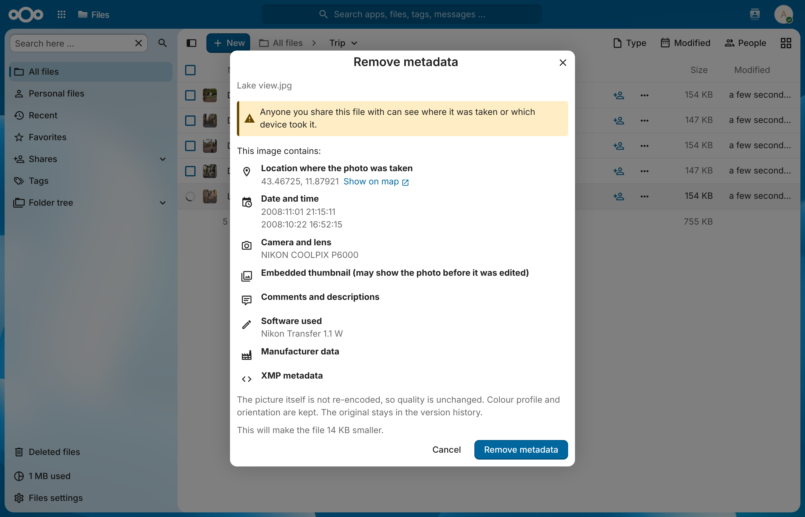
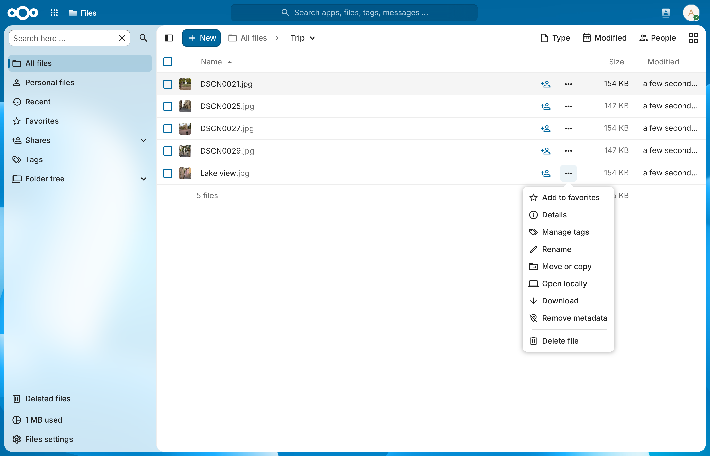
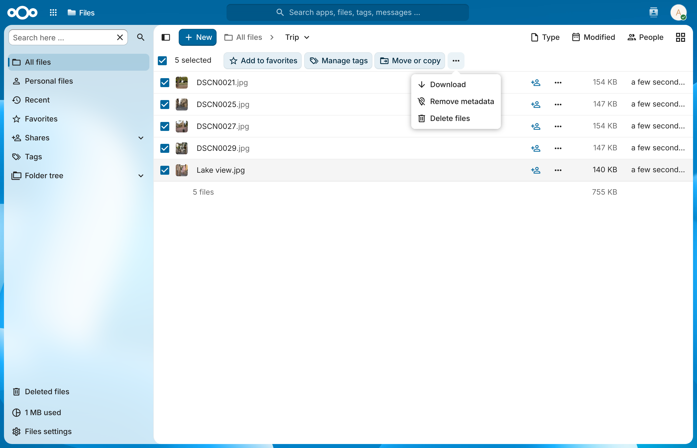
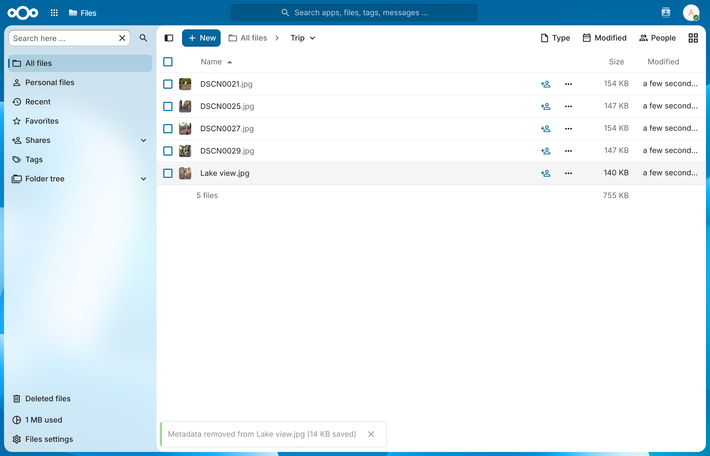

<!--
  - SPDX-FileCopyrightText: 2026 Metadata Scrubber contributors
  - SPDX-License-Identifier: AGPL-3.0-or-later
-->

# 🧽 Metadata Scrubber for Nextcloud

**Remove GPS location, camera details and other hidden metadata from photos, right in the Files app.**

Photos carry more than pixels. A picture straight from a phone usually records exactly where it was taken, the device's serial number, the time, the editing software, and sometimes a hidden thumbnail or a whole motion-photo video appended after the image. Share that file and you share all of it.

Metadata Scrubber adds a **Remove metadata** action to Nextcloud Files. It shows you what a photo reveals, then strips it **losslessly**: the image data is copied byte for byte, never re-encoded.



## Features

- 🔍 **See before you scrub.** The dialog lists what the file reveals: coordinates (with a map link), camera, serial numbers, dates, author, software…
- 🧽 **Lossless.** JPEG scans, PNG `IDAT` and WebP bitstreams are copied untouched. Pixel output is identical, and tests verify that.
- 🧭 **Keeps what affects appearance.** ICC colour profiles, the Adobe colour-transform marker and the orientation flag survive (orientation is rewritten as a tiny orientation-only EXIF block), so nothing turns sideways or changes colour.
- 🕵️ **Catches hidden extras.** Embedded thumbnails, MPF data and trailing payloads such as motion-photo videos and Ultra HDR gain maps.
- ↩️ **Safe.** Files are written through Nextcloud's filesystem API, so the original stays in the file's **version history**.
- 📦 **Batch.** Select many photos and clean them in one go.
- 🔐 **Permission-aware.** Read-only shares can be inspected but not changed. Other users' files are invisible (404).
- 🪶 **Zero dependencies.** Pure PHP, with no ImageMagick, exiftool or external service.

Supported formats: **JPEG, PNG, WebP**.

| Files menu | Batch action | Done |
|---|---|---|
|  |  |  |

## What is removed vs. kept

| Format | Removed | Kept |
|---|---|---|
| JPEG | EXIF (`APP1`), XMP and extended XMP, IPTC/Photoshop (`APP13`), MPF & FlashPix (`APP2`), JFXX thumbnails, vendor `APP3`–`APP15`, comments (`COM`), anything after `EOI` | JFIF, ICC profile, Adobe `APP14`, all decoding segments, orientation |
| PNG | `tEXt`, `zTXt`, `iTXt` (incl. XMP), `eXIf`, `tIME`, `dSIG`, data after `IEND` | all other chunks (`iCCP`, `sRGB`, `gAMA`, `pHYs`, APNG…), orientation |
| WebP | `EXIF`, `XMP `, unknown chunks, data after the RIFF container | `VP8`/`VP8L`/`ALPH`/`ANIM`/`ANMF`/`ICCP`; `VP8X` flags are updated |

## Installation

**From the App Store:** *Apps → Files → Metadata Scrubber → Download and enable* (once published).

**Manually:**

```bash
cd /path/to/nextcloud/apps
git clone https://github.com/pratik-mahalle/metascrub.git
cd metascrub && npm ci && npm run build
sudo -u www-data php ../../occ app:enable metascrub
```

Requires Nextcloud 33–35 and PHP 8.2+.

### Configuration

Files are processed in memory, so there is a size limit (default 64 MB):

```bash
occ config:app:set metascrub max_file_size_mb --value=128 --type=integer
```

## How it works

```
Files app ──(init script)──► registers the "Remove metadata" FileAction
   │                          (≈26 KB gz; Vue, dialog & HTTP client are lazy-loaded on click)
   ▼
ScrubDialog.vue ──GET  /ocs/v2.php/apps/metascrub/api/v1/files/{id}────────► analyze
               ──POST /ocs/v2.php/apps/metascrub/api/v1/files/{id}/scrub──► scrub
                                                     │
                       ApiController (OCS, rate limited, NoAdminRequired)
                                                     │
                       ScrubService ── IRootFolder → user folder → File
                                                     │   (permission checks, putContent → new version)
                       Scrubber (pure PHP, no Nextcloud deps)
                         ├─ JPEG segment walker (handles progressive scans, RST, fill bytes)
                         ├─ PNG chunk filter (re-computes CRC for the orientation chunk)
                         ├─ WebP RIFF rewriter (clears VP8X flags, fixes RIFF size)
                         └─ ExifInspector + TiffReader (bounds-checked IFD parsing → findings)
```

Some design decisions:

- **Detect by magic bytes, not MIME type.** The scrubber trusts file contents, not extensions.
- **Refuse rather than mangle.** Any structural inconsistency raises `CorruptFileException` and the file is left untouched. A fuzz test flips and truncates bytes hundreds of times to make sure this never turns into a PHP warning or a broken file.
- **The backend returns stable finding types** (`location`, `serial`…), and the frontend maps them to translated labels.
- **Clean files are never rewritten**, so no pointless versions are created.

### API

Both endpoints require a logged-in user and the `OCS-APIRequest: true` header.

```bash
curl -u alice:pass -H 'OCS-APIRequest: true' -H 'Accept: application/json' \
  https://cloud.example.com/ocs/v2.php/apps/metascrub/api/v1/files/123

curl -u alice:pass -H 'OCS-APIRequest: true' -H 'Accept: application/json' -X POST \
  https://cloud.example.com/ocs/v2.php/apps/metascrub/api/v1/files/123/scrub
```

| Status | Meaning |
|---|---|
| 200 | Report (and, for `scrub`, `changed`, `size`, `mtime`, `etag`) |
| 400 | Not a JPEG/PNG/WebP, or the image is damaged |
| 403 | No permission to modify (e.g. read-only share) |
| 404 | File not found or not visible to you |
| 413 | Larger than `max_file_size_mb` |

## Development

```bash
composer install && composer test:unit   # PHPUnit
npm ci && npm run typecheck && npm run build
npm run watch                            # rebuild on change
make appstore                            # build/artifacts/metascrub.tar.gz
```

The unit tests generate real JPEG/PNG/WebP files with GD and inject metadata the way cameras and editors write it. Each test then checks that the pixels are identical, the metadata is gone, orientation and ICC survive, scrubbing twice changes nothing, and damaged input is rejected safely.

The scrubber was also run against the 91 photos of the public [exif-samples](https://github.com/ianare/exif-samples) collection (Canon, Nikon, Sony, Fuji, Olympus, phones…): 90 came out pixel-identical with no metadata left, and the one intentionally corrupted sample was refused. Development testing was done on Nextcloud 34.0.6.

## Roadmap

- [ ] Optional automatic scrubbing on upload (per user or per folder)
- [ ] "Remove location only" mode
- [ ] HEIC/AVIF support
- [ ] Clean a copy instead of the original
- [ ] Translations via Transifex

## License

AGPL-3.0-or-later. See [LICENSE](LICENSE).
